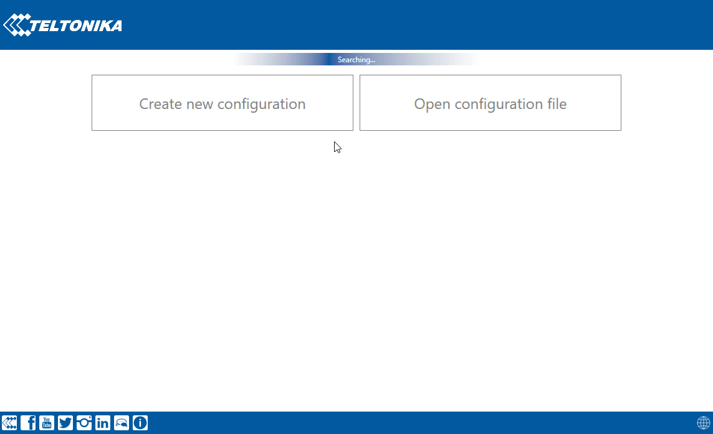
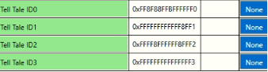

# FMS Tell Tale Status

# FMS Tell Tale Status Introduction

Tell Tale was created in order to receive all available dashboard indication events that are available on truck via FMS protocol according to J1939 standard.
SAE J1939 is the vehicle bus standard used for communication and diagnostics among vehicle components. Based on the same architecture FMS protocol dedicated to telematics systems is available. It has certain standardized parameters available, such as fuel consumption, engine work-hours, etc. Please visit [http://www.fms-standard.com/](http://www.fms-standard.com/) for more information and message structure.

# Is there any Tell Tale parameters available on my vehicle?

To check if any Tell Tale parameters are available via FMS on your vehicle **scanfms** SMS/GPRS command can be used. If there is any parameters available on FMS this means that Tell Tale status is available as well. Response will show parameters that are available on vehicle, but it does not include all Tell Tale statuses - only MIL indication is implemented see [FMS elements](https://wiki.teltonika-gps.com/view/FMB640_Teltonika_Data_Sending_Parameters_ID#FMS_elements). How to parse scanfms response can be found in wiki [FMB_scanfms](https://wiki.teltonika-gps.com/view/FMB_scanfms) page.

# What parameters should be enabled

FMBX640 have CAN1 and CAN2 BUS lines that are already configured.

- FMB640 CAN1 connected to vehicle's FMS(J1939) BUS line
- FMB640 CAN2 connected to vehicle's Tachograph

More information in [CAN\Tachograph paragraph](https://wiki.teltonika-gps.com/view/FMB640_CAN_%5C_Tachograph)

Configurable parameters via SMS/GPRS commands can be found at [FMB640_Device_Family_Parameter_list#FMS](https://wiki.teltonika-gps.com/view/FMB640_Device_Family_Parameter_list#FMS)

# How does it work?

IO element describes Tell Tale Block ID message received from Block ID 0,1,2,3 in Hexadecimal format.:

- Tell Tale ID0
- Tell Tale ID1
- Tell Tale ID2
- Tell Tale ID3

Each ID represents Block ID of Tell Tale.

IO elements store information that is received from FMS Tell Tale Status message (CAN ID - 0x00FD7D).
Status message sends Data Block information in Data Byte 1. Block ID is determined by Data Byte 1 first 4 Bits. Example in hexadecimal first 4 bits where X – random byte value.

1. X016 – Block ID 0 - FMS IO element Tell Tale ID0
2. X116 – Block ID 1 - FMS IO element Tell Tale ID1
3. X216 – Block ID 2 - FMS IO element Tell Tale ID2
4. X316 – Block ID 3 - FMS IO element Tell Tale ID3

Once Block ID is captured all 8 bytes of Tell Tale message are saved to corresponding Tell Tale IO element.

Example of FMS Tell Tale status data:

When device is powered up all elements are be updated to the first corresponding message.

After 4 seconds (1000 ms per Block ID) all values will be captured again. Device checks last saved value of Tell Tale IO elements and if it is changed – values are updated.

# How to parse Tell Tale message

Bytes should be read from Right <<< To left. 4th and 8th Bits are not defined

Statuses are described in FMS document.
See Table for Tell Tale statuses, page 27 (60)
Binary table to determine indication status can be found in 1.1.16 FMS Tell Tale Status: FMS1, Page 26 (60)

Received data:

Block ID = 0| 0xFF8F88FFBFFFFFF0

1 Byte FF | Binary 1 111 1111 | Status 1 -Not avail.; Block
2 Byte 8F | Binary 1000 1111 | Status 2- Not avail.;3 - reserved|
3 Byte 88 | Binary 1000 1000 | Status 4- Reserved;5 - Reserved|
4 Byte FF | Binary 1111 1111 | Status 6- Not avail.;7- Not avail.|

5 Byte BF | Binary 1011 1111 | Status 8- Not avail.;9- Reserved
6 Byte FF | Binary 1111 1111 | Status 10- Not avail.;11- Not avail.
7 Byte FF | Binary 1111 1111 | Status 12- Not avail.;13- Not avail.
8 Byte F0 | Binary 1111 0000 | Status 14- OFF (Position lights,side lights) ;15- Not avail.

Block ID = 1| 0xFFFFFFFFFFFF8FF1

1 Byte FF | Binary 1111 1111 | Status 1-not avail;Block |
2 Byte FF | Binary 1111 1111 | Status 2- Not avail;3- Not avail |
3 Byte FF | Binary 1111 1111 | Status 4- Not avail;5- Not avail |
4 Byte FF | Binary 1111 1111 | Status 6- Not avail;7- Not avail |
5 Byte FF | Binary 1111 1111 | Status 8- Not avail;9- Not avail |
6 Byte FF | Binary 1111 1111 | Status 10- Not avail;11- Not avail|
7 Byte 8F | Binary 1000 1111 | Status 12- Not avail;13-OFF Engine oil level |
8 Byte F1 | Binary 1111 0001 | 14- Condition Red Engine coolant level ;Status 15- Not avail |

Block ID = 2| 0xFFFF8FFFFFF8FFF2

1 Byte FF | Binary 1111 1111 | Status 1-not avail; Block
2 Byte FF | Binary 1111 1111 | Status 2-not avail;3-not avail
3 Byte 8F | Binary 1000 1111 | Status 4-OFF, Engine Emission system failure (Mil indicator);5- reserved
4 Byte FF | Binary 1111 1111 | Status 6-not avail;7-not avail

5 Byte FF | Binary 1111 1111 | Status 8-not avail;9-not avail
6 Byte F8 | Binary 1111 1000 | Status 10-OFF, Bus stop brake ;11-not avail
7 Byte FF | Binary 1111 1111 | Status 12-not avail;13-not avail
8 Byte F2 | Binary 1111 0010 | Status 14-Condition Yellow, Kneeling;15-not avail

Block ID = 3| 0xFFFFFFFFFFFFFFF3

1 Byte FF | Binary 1111 1111 | Status 1-not avail; Block
2 Byte FF | Binary 1111 1111 | Status 2-not avail;3-not avail
3 Byte 8F | Binary 1111 1111 | Status 4-not avail;-not avail
4 Byte FF | Binary 1111 1111 | Status 6-not avail;7-not avail

5 Byte FF | Binary 1111 1111 | Status 8-not avail;9-not avail
6 Byte F8 | Binary 1111 1111 | Status 10-not avail;11-not avail
7 Byte FF | Binary 1111 1111 | Status 12-not avail;13-not avail
8 Byte F3 | Binary 1111 0011 | Status 14-Condition Info, ESC switched off;15-not avail

# Quick links

[FMS-Standard Description Document](https://fms-standard.com/Truck/down_load/fms%20document_v_05_vers.24.11.2023.pdf)

|  | Tell Tale only available on vehicles that support FMS standard |
| --- | --- |

|  | Tell Tale examples are provided in FMS-Standard Description document that is publicly available |
| --- | --- |

|  | Availability of parameter depends on vehicle’s model and configuration of the FMS interface of the truck. |
| --- | --- |

|  | Note: FMS Tell Tale status is supported on FMC650 FMM650 FMB640 FMC640 FMM640 FMB630 FM6300 devices. Also please check firmware errata table to see from which firmware version this feature is available. |
| --- | --- |
