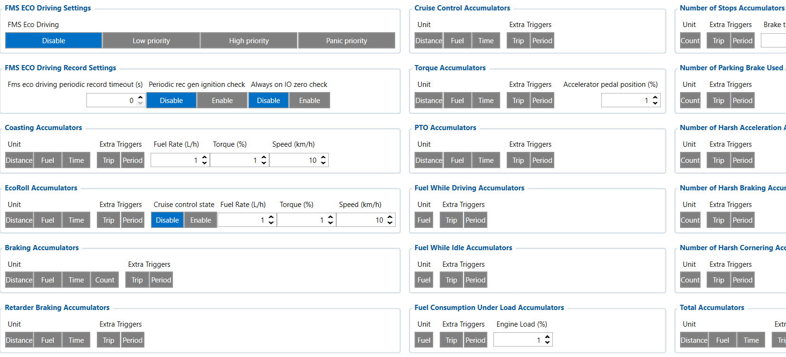

# FMSED — Configurator notes (EN)

> **Note:** Supplementary notes extracted from the French PDF of the
> Configurator tab `fmsed-tab.pdf`, generated on
> **2026-11-05T08:37:58Z** — newer than the wiki snapshot kept in
> this folder. The text was translated into English; it complements the
> reference page [`fms-eco-driving.md`](../fms-eco-driving.md).
> PDF extraction quirks: section titles sometimes appear after the text
> they introduce, figures reuse file names from page 1, and some wide
> tables are restituted row by row because the PDF text layer does not
> always preserve the columns. Unarchived `docs.tinolyx.com` image links
> were removed; unique figures are grouped under `## Figures`.

<!-- PDF p. 2 -->

The FMSED tab (FMS Eco Driving Data) is the calculation and statistical processing engine
for eco-driving on the FMC650. It is used to:

1. Transform instantaneous values into cumulative statistics: Rather than simply transmitting an engine speed or instantaneous consumption, FMSED calculates aggregated indicators (e.g. total litres consumed at idle, distance travelled in over-rev).

2. Standardize driver scoring: Provide objective metrics (harsh braking, time under cruise control, retarder usage, anticipation in EcoRoll) to compare fleet drivers fairly.

3. Optimize bandwidth and storage: By accumulating events in the device via accumulators, the FMC650 reduces the number of frames sent to the server while delivering highly detailed analytical reports.

4. Report a usage profile to Wialon: Allows Wialon to display advanced dashboards on eco-driving, hardware wear and targeted consumption (idle vs rolling).

## FMSED

### 1. General Configuration & Periodicity (FMS ECO Driving Settings)

<!-- PDF p. 3 -->

Parameters governing the activation of the eco-driving function and the record generation
rules.

**FMS Eco Driving**

Meaning: Priority level of the FMS eco-driving module ( Disable , Low , High , Panic ).
Current value: Disable .
Role: Enable or disable the entire FMS eco-driving calculator ( Disable = the module is inactive, no statistics are generated).

**Fms Eco Driving Periodic Record Timeout & Ignition Check**

Meaning: Interval for generating periodic records (in seconds) and ignition check ( Disable / Enable ).
Current values: 0 s / Disable .
Role: Schedules the regular sending of eco-driving reports and makes their
sending conditional on the ignition line state (ignition on or off).
Statistical counters dedicated to the different driving phases and to the use of the truck's
equipment.

**Coasting & EcoRoll Accumulators**

Meaning: Statistics for rolling in freewheel or decelerating without
engine load.
Role: Measures the distance, time and fuel consumed when the
driver anticipates the terrain and lets the vehicle roll (Thresholds defined e.g.: Speed = 10 km/h, Torque = 1%).

**Braking & Retarder Braking Accumulators**

Meaning: Cumulative total of the main braking phases (pedal) and of the
auxiliary brake (retarder).

### 2. Driving and Behaviour Accumulators (Style & Usage Accumulators)

<!-- PDF p. 4 -->

Role: Analyse brake wear and optimal retarder usage on
heavy vehicles (time, distance, count).

**Cruise Control & Torque Accumulators**

Meaning: Time/distance spent under cruise control and phases of strong
acceleration (pedal depressed).
Role: Evaluate driving consistency on motorways and the intensity of
mechanical stress.

**PTO Accumulators (Power Take-Off)**

Meaning: Statistics on power take-off usage (hydraulic equipment, crane, tipper).
Role: Isolate the fuel and engine hours consumed when
auxiliary equipment operates while stationary.
Counting of fuel volumes by operating mode and safety events.

**Fuel While Driving / Fuel While Idle / Fuel Under Load Accumulators**

Meaning: Breakdown of the fuel consumed while rolling, at idle (stopped with engine running) and under heavy engine load.
Role: Precisely identify waste at idle (Fuel Idle) and the impact of
load on consumption.

**Harsh Events (Acceleration, Braking, Cornering) & Parking Brake**

Meaning: Counters for harsh accelerations, violent braking, tight
cornering and parking brake usage.
Role: Quantify the level of risk and driving harshness to feed an
eco-driving or insurance score.
Segmentation of driving metrics into customizable ranges.

### 3. Fuel & Event Accumulators

### 4. Advanced Statistical Ranges (Range Accumulators)

<!-- PDF p. 5 -->

**Speed, RPM, Torque, Braking Force & Fuel Rate Ranges**

Meaning: Accumulators split into ranges (e.g. 0–1000 RPM, 1000–1500 RPM / 0–60 km/h, 60–80 km/h).
Role: Build detailed histograms of engine and vehicle usage
(Currently not configured in your file: empty ).
Global summary of the 3 tabs (LVCAN / FMS I/O / FMSED)
```
        ┌────────────────────────────────────────────────────────┐
        │                     TRUCK CHASSIS                      │
        └──────────────────────────┬─────────────────────────────┘
                                   │
              ┌────────────────────┴────────────────────┐
              ▼                                         ▼
   [ STANDARD FMS NORM ]                      [ MANUFACTURER CAN BUS ]
              │                                         │
              ▼                                         ▼
     ┌─────────────────┐                       ┌─────────────────┐
     │  FMS I/O Tab    │                       │   LVCAN Tab     │
     │  (CAN Reading)  │                       │  (LV Interface) │
     └────────┬────────┘                       └────────┬────────┘
              │                                         │
              └────────────────────┬────────────────────┘
                                   │ Raw data (RPM, Speed, Fuel, Axle Weight...)
                                   ▼
                       ┌──────────────────────┐
                       │     FMSED Tab        │
                       │ (Calculation engine) │
                       └───────────┬──────────┘
                                   │ Calculated statistics & Accumulators
                                   ▼
                       ┌──────────────────────┐
                       │     FMS ECO Tab      │
                       │ (I/O Visualization)  │
                       └───────────┬──────────┘
```

<!-- PDF p. 6 -->

1. LVCAN / FMS I/O (Capture): They read the raw data sent by the vehicle
(speed, RPM, fuel, axle weight, warning lights).
2. FMSED (Processing): It applies the eco-driving algorithms to this raw data
to fill accumulators (idle time, fuel under load, harsh braking).
3. FMS ECO (Result): It exposes the values of the accumulators calculated by FMSED as
I/Os (Inputs/Outputs) so that they can be included in the frame sent to Wialon Local.
```
                                   │ AVL Frame (Teltonika Protocol)
                                   ▼
                       ┌──────────────────────┐
                       │     WIALON LOCAL     │
                       └──────────────────────┘
```

## Figures

Unique figures extracted from the PDF. The extraction reuses the same file
names for all pages; each image is therefore referenced only once here.



