# FMC650 FMS Eco Driving

# Description

Overall purpose of FMS ECO Driving is to monitor drivers behavior by reading FMS CAN data from the truck and sending a report to the server which allows the fleet manager to see the driving style of specific drivers - good driving styles can be rewarded, and bad driving styles can be corrected. Good driving style means that the driver is using the whole spectrum of trucks capability - engine breaking (retarder), coasting, cruise control etc. and is predicting the road/traffic conditions ahead - using the momentum of the truck when needed, not overusing the brakes etc.

The main benefit for the client is that FMS ECO Driving report allows them to make and monitor driver behavior changes to save fuel costs and maintenance cost of the truck - saving more revenue and making the company more environmentally friendly.

Additionally, clients can also reduce the data traffic of the device and save data cost as well - instead of monitoring live FMS data from the trucks - new functionality accumulates the data inside the device and sends a report by specified triggers/period.

**Note:** 03.01.00.Rev.14 Firmware is needed for FMS Eco Driving functionality.

# Notion List

**Cruise control -** selectable option in the truck - by using cruise control the truck can use optimal fuel consumption to maintain the speed window selected by the driver.

Load videoLocal FileLocal File might collect personal data.https://wiki.teltonika-gps.com/view/File:Cruise_Control.mp4**ECO Roll -** option that if enabled in truck uses neutral gear to roll using truck momentum on slopes

Load videoLocal FileLocal File might collect personal data.https://wiki.teltonika-gps.com/view/File:EcoRoll.mp4**Coasting -** similar to ECO Roll, however the Cruise Control is not active and gear is not neutral - simply letting off the accelerator pedal.

Load videoLocal FileLocal File might collect personal data.https://wiki.teltonika-gps.com/view/File:Driver_Support_Score.mp4**Power take-off (PTO) -** is a device that transfers an engine's mechanical power to another piece of equipment.

Load videoLocal FileLocal File might collect personal data.https://wiki.teltonika-gps.com/view/File:PTO.mp4**Retarder –** A hydraulic accessory that is connected to a gearbox which slows down the truck by slowing down the gearbox. It is operated by levr in the truck.

| Load video Local File Local File might collect personal data. Continue Dismiss https://wiki.teltonika-gps.com/view/File:Retarder1.mp4 | Load video Local File Local File might collect personal data. Continue Dismiss https://wiki.teltonika-gps.com/view/File:Retarder2.mp4 |
| --- | --- |

# FMS eco driving functionality working

## Units

Driver behaviour can be monitored via various accumulators - Distance travelled in specific state and/or Fuel used in specific state and/or Time spent in specific state. Additionally count accumulator is also available for specific elements.

Client can select what accumulator is required to him by enabling it in configurator. For example, Braking Accumulator:

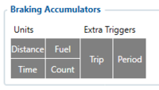In report you can get:

- distance travelled while brake pedal was depressed
- fuel used while brake pedal was depressed
- time in seconds of how long the brake pedal was depressed during the trip
- count - number of times the brake pedal was depressed

**Example:** report states that Braking accumulator count is 10 while distance travelled while brake pedal was depressed is 2 km - the driver is feathering the brake to slow down the truck instead of using engine braking.

**Important:** IO elements appear in record if the trigger that generated the event is enabled for the element - for example report is generated by trip end - periodical accumulators will not be included in the record and vice versa. However - more than one trigger can be selected.

## Triggers and others

As mentioned, - FMS ECO driving is a report-based functionality - purpose is to get a report on drivers' behaviour after each trip he takes and not to monitor the data while the trip is happening, however a possibility for that also exists.
Some Triggers are hardcoded, for example:

- **Startup –** Permanent trigger. Generated on device start-up. Indicates that accumulation has begun.
- **Powerdown –** Permanent trigger. Generated on device reset command. Intended for saving current accumulators to Flash on software reset.

- **DriverID –** Permanent trigger. Generated on active driver ID change detection. Changing driver ID should always send current accumulators so that they would not be assigned to another driver. Two reports are sent on this trigger: one before accumulators are reset (to get a report for the previous driver) and one after (to get a reference starting point for a new driver).

- **EndOfDay –** Permanent trigger. Generated every 24h near midnight. Event is triggered in time interval from 23:56 to 00:00. All accumulators are sent and cleared.

Clients can also select additional triggers for each element - Trip/Periodic:

- **Periodic –** Configurable trigger. Only accumulators that have “Periodic” setting configured are sent and cleared. Generated after every periodic Tacho record generation (separate period configuration will be available in upcoming release).

- **Tachograph Record Settings** in "Tachograph Data" Tab:

[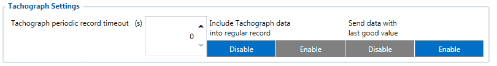](https://wiki.teltonika-gps.com/view/File:FMB640_Tachograph_Settings.gif)

- **Trip Start –** Configurable trigger. Only accumulators that have “Trip” setting configured are sent and cleared. Generated on trip start.
- **Trip End –** Configurable trigger. Only accumulators that have “Trip” setting configured are sent and cleared. Generated on trip end.

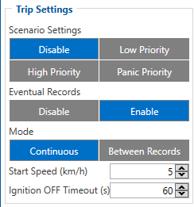*Trip Settings from "Trop/Odometer" Tab*

# FMS Eco Driving Report Structure

FMS report comes in separate record with specific **AVL ID - 12000**. The value of AVL ID specifies what trigger generated the report.

After each FMS ECO Driving report is generated - the accumulators are renewed - counting starts from zero.

The record structure description could be found [**HERE**](https://wiki.teltonika-gps.com/view/FMS_Eco_Driving_Report_Structure)

# FMS Eco Driving AVL ID List and description

All enabled elements have their specific AVL IDs - Braking Accumulators shown before are configurable with same Parameter ID, but all have specific AVL IDs.
Full list can be found [**HERE**](https://wiki.teltonika-gps.com/view/FMC650_Teltonika_Data_Sending_Parameters_ID)

| **Record Structure** | — | — | — | — | — | — |
| --- | --- | --- | --- | --- | --- | --- |
| **IO Name** | **Config ID** | **AVL ID** | **Value / Unit** | **IO size, Bytes** | **Notes** | — |
| — | Event Type | 125000 | 12000 | 0 – Periodic / 1 – Trip Start / 2 – Trip End / 3 – Driver change / 4 – Device startup / 5 – Device off / reset / 6 – End of Day / ​​​​​​​7 – VIN Change | 1B | Event IO ID |
| — | Ignition | – | 239 | 0 – OFF 1 – ON | 1B | Always included |
| — | Trip | – | 250 | 0 – Non active / 1 – Active | 1B | Always included |
| — | Total Distance | – | 192 | meters | 4B | Always included |
| — | Engine Fuel used | – | 138 | millilitres | 4B | Always included |
| — | Active Driver ID | – | 12001 | <string> | — | Always included |
| — | VIN Number | – | 12002 | <string> | — | Always included |
| — | Event Counter | – | 12003 | – | 2B | Always included |
| — | Coasting Distance | 125010 | 12010 | meters | 4B | — |
| — | Coasting Fuel used | 125010 | 12011 | millilitres | 4B | — |
| — | Coasting Time | 125010 | 12012 | seconds | 4B | — |
| — | EcoRoll Distance | 125020 | 12013 | meters | 4B | — |
| — | EcoRoll Fuel used | 125020 | 12014 | millilitres | 4B | — |
| — | EcoRoll Time | 125020 | 12015 | seconds | 4B | — |
| — | Braking Distance | 125030 | 12016 | meters | 4B | — |
| — | Braking Fuel used | 125030 | 12017 | millilitres | 4B | — |
| — | Braking Time | 125030 | 12018 | seconds | 4B | — |
| — | Braking Count | 125030 | 12019 | – | 2B | — |
| — | Retarder Distance | 125040 | 12020 | meters | 4B | — |
| — | Retarder Fuel used | 125040 | 12021 | millilitres | 4B | — |
| — | Retarder Time | 125040 | 12022 | seconds | 4B | — |
| — | Cruise Distance | 125050 | 12023 | meters | 4B | — |
| — | Cruise Fuel used | 125050 | 12024 | millilitres | 4B | — |
| — | Cruise Time | 125050 | 12025 | seconds | 4B | — |
| — | Torque Distance | 125060 | 12026 | meters | 4B | — |
| — | Torque Fuel used | 125060 | 12027 | millilitres | 4B | — |
| — | Torque Time | 125060 | 12028 | seconds | 4B | — |
| — | PTO Distance | 125070 | 12029 | meters | 4B | — |
| — | PTO Fuel used | 125070 | 12030 | millilitres | 4B | — |
| — | PTO Time | 125070 | 12031 | seconds | 4B | — |
| — | Fuel While Driving fuel | 125080 | 12032 | millilitres | 4B | — |
| — | Fuel While Idle fuel | 125090 | 12033 | millilitres | 4B | — |
| — | Engine Load fuel | 125100 | 12034 | millilitres | 4B | — |
| — | Total Distance | 125110 | 12035 | meters | 4B | — |
| — | Total Fuel used | 125110 | 12036 | millilitres | 4B | — |
| — | Total Time | 125110 | 12037 | seconds | 4B | — |
| — | Short Stops Count | 125250 | 12050 | – | 2B | — |
| — | Long Stops Count | 125250 | 12051 | – | 2B | — |
| — | Speed Range 1 Distance | 125500 | 12100 | meters | 4B | — |
| — | Speed Range 2 Distance | 125500 | 12101 | meters | 4B | — |
| — | Speed Range 3 Distance | 125500 | 12102 | meters | 4B | — |
| — | Speed Range 4 Distance | 125500 | 12103 | meters | 4B | — |
| — | Speed Range 5 Distance | 125500 | 12104 | meters | 4B | — |
| — | Speed Range 6 Distance | 125500 | 12105 | meters | 4B | — |
| — | Speed Range 7 Distance | 125500 | 12106 | meters | 4B | — |
| — | Speed Range 8 Distance | 125500 | 12107 | meters | 4B | — |
| — | Speed Range 9 Distance | 125500 | 12108 | meters | 4B | — |
| — | Speed Range10 Distance | 125500 | 12109 | meters | 4B | — |
| — | Speed Range 1 Fuel used | 125500 | 12110 | milliliters | 4B | — |
| — | Speed Range 2 Fuel used | 125500 | 12111 | milliliters | 4B | — |
| — | Speed Range 3 Fuel used | 125500 | 12112 | milliliters | 4B | — |
| — | Speed Range 4 Fuel used | 125500 | 12113 | milliliters | 4B | — |
| — | Speed Range 5 Fuel used | 125500 | 12114 | milliliters | 4B | — |
| — | Speed Range 6 Fuel used | 125500 | 12115 | milliliters | 4B | — |
| — | Speed Range 7 Fuel used | 125500 | 12116 | milliliters | 4B | — |
| — | Speed Range 8 Fuel used | 125500 | 12117 | milliliters | 4B | — |
| — | Speed Range 9 Fuel used | 125500 | 12118 | milliliters | 4B | — |
| — | Speed Range10 Fuel used | 125500 | 12119 | milliliters | 4B | — |
| — | Speed Range 1 Time | 125500 | 12120 | seconds | 4B | — |
| — | Speed Range 2 Time | 125500 | 12121 | seconds | 4B | — |
| — | Speed Range 3 Time | 125500 | 12122 | seconds | 4B | — |
| — | Speed Range 4 Time | 125500 | 12123 | seconds | 4B | — |
| — | Speed Range 5 Time | 125500 | 12124 | seconds | 4B | — |
| — | Speed Range 6 Time | 125500 | 12125 | seconds | 4B | — |
| — | Speed Range 7 Time | 125500 | 12126 | seconds | 4B | — |
| — | Speed Range 8 Time | 125500 | 12127 | seconds | 4B | — |
| — | Speed Range 9 Time | 125500 | 12128 | seconds | 4B | — |
| — | Speed Range 10 Time | 125500 | 12129 | seconds | 4B | — |
| — | RPM Range 1 Distance | 125510 | 12130 | meters | 4B | — |
| — | RPM Range 2 Distance | 125510 | 1213 | meters | 4B | — |
| — | RPM Range 3 Distance | 125510 | 12132 | meters | 4B | — |
| — | RPM Range 4 Distance | 125510 | 12133 | meters | 4B | — |
| — | RPM Range 5 Distance | 125510 | 12134 | meters | 4B | — |
| — | RPM Range 6 Distance | 125510 | 12135 | meters | 4B | — |
| — | RPM Range 7 Distance | 125510 | 12136 | meters | 4B | — |
| — | RPM Range 8 Distance | 125510 | 12137 | meters | 4B | — |
| — | RPM Range 9 Distance | 125510 | 12138 | meters | 4B | — |
| — | RPM Range10 Distance | 125510 | 12139 | meters | 4B | — |
| — | RPM Range 1 Fuel used | 125510 | 12140 | milliliters | 4B | — |
| — | RPM Range 2 Fuel used | 125510 | 12141 | milliliters | 4B | — |
| — | RPM Range 3 Fuel used | 125510 | 12142 | milliliters | 4B | — |
| — | RPM Range 4 Fuel used | 125510 | 12143 | milliliters | 4B | — |
| — | RPM Range 5 Fuel used | 125510 | 12144 | milliliters | 4B | — |
| — | RPM Range 6 Fuel used | 125510 | 12145 | milliliters | 4B | — |
| — | RPM Range 7 Fuel used | 125510 | 12146 | milliliters | 4B | — |
| — | RPM Range 8 Fuel used | 125510 | 12147 | milliliters | 4B | — |
| — | RPM Range 9 Fuel used | 125510 | 12148 | milliliters | 4B | — |
| — | RPM Range10 Fuel used | 125510 | 12149 | milliliters | 4B | — |
| — | RPM Range 1 Time | 125510 | 12150 | seconds | 4B | — |
| — | RPM Range 2 Time | 125510 | 12151 | seconds | 4B | — |
| — | RPM Range 3 Time | 125510 | 12152 | seconds | 4B | — |
| — | RPM Range 4 Time | 125510 | 12153 | seconds | 4B | — |
| — | RPM Range 5 Time | 125510 | 12154 | seconds | 4B | — |
| — | RPM Range 6 Time | 125510 | 12155 | seconds | 4B | — |
| — | RPM Range 7 Time | 125510 | 12156 | seconds | 4B | — |
| — | RPM Range 8 Time | 125510 | 12157 | seconds | 4B | — |
| — | RPM Range 9 Time | 125510 | 12158 | seconds | 4B | — |
| — | RPM Range 10 Time | 125510 | 12159 | seconds | 4B | — |
| — | Torque Range 1 Distance | 125520 | 12160 | meters | 4B | — |
| — | Torque Range 2 Distance | 125520 | 12161 | meters | 4B | — |
| — | Torque Range 3 Distance | 125520 | 12162 | meters | 4B | — |
| — | Torque Range 4 Distance | 125520 | 12163 | meters | 4B | — |
| — | Torque Range 5 Distance | 125520 | 12164 | meters | 4B | — |
| — | Torque Range 6 Distance | 125520 | 12165 | meters | 4B | — |
| — | Torque Range 7 Distance | 125520 | 12166 | meters | 4B | — |
| — | Torque Range 8 Distance | 125520 | 12167 | meters | 4B | — |
| — | Torque Range 9 Distance | 125520 | 12168 | meters | 4B | — |
| — | Torque Range10 Distance | 125520 | 12169 | meters | 4B | — |
| — | Torque Range 1 Fuel used | 125520 | 12170 | millilitres | 4B | — |
| — | Torque Range 2 Fuel used | 125520 | 12171 | millilitres | 4B | — |
| — | Torque Range 3 Fuel used | 125520 | 12172 | millilitres | 4B | — |
| — | Torque Range 4 Fuel used | 125520 | 12173 | millilitres | 4B | — |
| — | Torque Range 5 Fuel used | 125520 | 12174 | millilitres | 4B | — |
| — | Torque Range 6 Fuel used | 125520 | 12175 | millilitres | 4B | — |
| — | Torque Range 7 Fuel used | 125520 | 12176 | millilitres | 4B | — |
| — | Torque Range 8 Fuel used | 125520 | 12177 | millilitres | 4B | — |
| — | Torque Range 9 Fuel used | 125520 | 12178 | millilitres | 4B | — |
| — | Torque Range10 Fuel used | 125520 | 12179 | millilitres | 4B | — |
| — | Torque Range 1 Time | 125520 | 12180 | seconds | 4B | — |
| — | Torque Range 2 Time | 125520 | 12181 | seconds | 4B | — |
| — | Torque Range 3 Time | 125520 | 12182 | seconds | 4B | — |
| — | Torque Range 4 Time | 125520 | 12183 | seconds | 4B | — |
| — | Torque Range 5 Time | 125520 | 12184 | seconds | 4B | — |
| — | Torque Range 6 Time | 125520 | 12185 | seconds | 4B | — |
| — | Torque Range 7 Time | 125520 | 12186 | seconds | 4B | — |
| — | Torque Range 8 Time | 125520 | 12187 | seconds | 4B | — |
| — | Torque Range 9 Time | 125520 | 12188 | seconds | 4B | — |
| — | Torque Range 10 Time | 125520 | 12189 | seconds | 4B | — |
| — | Braking Range 1 Distance | 125530 | 12590 | meters | 4B | — |
| — | Braking Range 2 Distance | 125530 | 12191 | meters | 4B | — |
| — | Braking Range 3 Distance | 125530 | 12192 | meters | 4B | — |
| — | Braking Range 4 Distance | 125530 | 12193 | meters | 4B | — |
| — | Braking Range 5 Distance | 125530 | 12194 | meters | 4B | — |
| — | Braking Range 6 Distance | 125530 | 12195 | meters | 4B | — |
| — | Braking Range 7 Distance | 125530 | 12196 | meters | 4B | — |
| — | Braking Range 8 Distance | 125530 | 12197 | meters | 4B | — |
| — | Braking Range 9 Distance | 125530 | 12198 | meters | 4B | — |
| — | Braking Range10 Distance | 125530 | 12199 | meters | 4B | — |
| — | Braking Range 1 Fuel used | 125530 | 12200 | millilitres | 4B | — |
| — | Braking Range 2 Fuel used | 125530 | 12201 | millilitres | 4B | — |
| — | Braking Range 3 Fuel used | 125530 | 12022 | millilitres | 4B | — |
| — | Braking Range 4 Fuel used | 125530 | 12203 | millilitres | 4B | — |
| — | Braking Range 5 Fuel used | 125530 | 12204 | millilitres | 4B | — |
| — | Braking Range 6 Fuel used | 125530 | 12205 | millilitres | 4B | — |
| — | Braking Range 7 Fuel used | 125530 | 12206 | millilitres | 4B | — |
| — | Braking Range 8 Fuel used | 125530 | 12207 | millilitres | 4B | — |
| — | Braking Range 9 Fuel used | 125530 | 12208 | millilitres | 4B | — |
| — | Braking Range10 Fuel used | 125530 | 12209 | millilitres | 4B | — |
| — | Braking Range 1 Time | 125530 | 12210 | seconds | 4B | — |
| — | Braking Range 2 Time | 125530 | 12211 | seconds | 4B | — |
| — | Braking Range 3 Time | 125530 | 12212 | seconds | 4B | — |
| — | Braking Range 4 Time | 125530 | 12213 | seconds | 4B | — |
| — | Braking Range 5 Time | 125530 | 12214 | seconds | 4B | — |
| — | Braking Range 6 Time | 125530 | 12215 | seconds | 4B | — |
| — | Braking Range 7 Time | 125530 | 12216 | seconds | 4B | — |
| — | Braking Range 8 Time | 125530 | 12217 | seconds | 4B | — |
| — | Braking Range 9 Time | 125530 | 12218 | seconds | 4B | — |
| — | Braking Range 10 Time | 125530 | 12219 | seconds | 4B | — |

# Parameter list

To configure via SMS/GPRS commands FMS ECO driving functionality you can find all parameters IDs [ **HERE**]

**Coasting Accumulators**

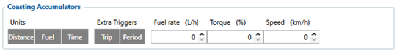*Coasting Accumulators* - feature that calculates elements when driver lets off accelerator pedal.
The Report can include:

| Units | Extra Triggers | Ranges |
| --- | --- | --- |
| Distance - distance travelled while accelerator pedal was left off | Periodic - Generated after every periodic Tacho record generation | Fuel rate (L/h) - Fuel rate threshold for coasting pattern to be detected |
| Fuel - fuel used while accelerator pedal was left off | Trip - Generated on Trip start or Trip end. | Torque (%) - Engine Torque threshold for coasting pattern to be detected |
| Time - time in seconds of how long the accelerator pedal was left off. | — | Speed (km/h) - Speed threshold for coasting pattern to be detected |

---

**EcoRoll Accumulators**

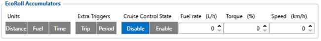*EcoRoll Accumulators* - feature that calculates elements when vehicle use gravity to roll in neutral.
The Report can include:

| Units | Extra Triggers |
| --- | --- |
| Distance - distance travelled while vehicle was rolling in neutral | Periodic - Generated after every periodic Tacho record generation |
| Fuel - fuel used while vehicle was rolling in neutral | Trip - Generated on Trip start or Trip end. |
| Time - time in seconds of how long the vehicle was rolling in neutral. | — |
| / | / |
| Cruise Control State | Ranges |
| Disable - When disabled coasting pattern is detected when fuel rate or Engine torque is below certain range. | Fuel rate (L/h) - Fuel rate threshold for EcoRoll pattern to be detected |
| Enable - When enabled coasting pattern is detected when vehicle is on neutral gear. | Torque (%) - Engine Torque threshold for EcoRoll pattern to be detected |
| — | Speed (km/h) - Speed threshold for EcoRoll pattern to be detected |

---

**Braking Accumulators**

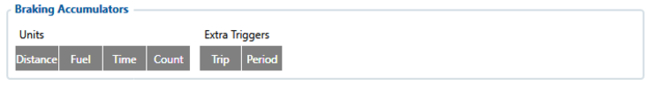*Braking Accumulators* - feature that calculates elements when brake pedal was depressed.
The Report can include:

| Units | Extra Triggers |
| --- | --- |
| Distance - distance travelled while vehicle's brake pedal was depressed | Periodic - Generated after every periodic Tacho record generation |
| Fuel - fuel used while brake pedal was depressed. | Trip - Generated on Trip start or Trip end. |
| Time - time in seconds of how long the brake pedal was depressed during the trip. | — |
| Count - number of times the brake pedal was depressed. | — |

---

**Retarder Accumulators**

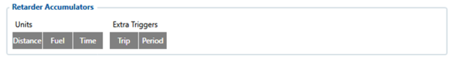*Retarder Accumulators* - feature that calculates elements when retarder in a vehicle is operated.
The Report can include:

| Units | Extra Triggers |
| --- | --- |
| Distance - distance travelled while vehicle's retarder was operated | Periodic - Generated after every periodic Tacho record generation |
| Fuel - fuel used while vehicle's retarder was operated | Trip - Generated on Trip start or Trip end. |
| Time - time in seconds of how long the retarder was operated. | — |

---

**Cruise Control Accumulators**

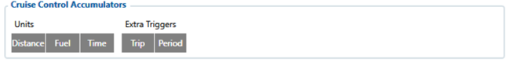*Cruise Control Accumulators* - feature that calculates elements when vehicle is on cruise control.
The Report can include:

| Units | Extra Triggers |
| --- | --- |
| Distance - distance travelled while vehicle was on cruise control. | Periodic - Generated after every periodic Tacho record generation |
| Fuel - fuel used while vehicle was on cruise control | Trip - Generated on Trip start or Trip end. |
| Time - time in seconds of how long the vehicle was on cruise control. | — |

---

**Torque Accumulators**

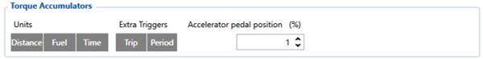*Torque Accumulators* - feature that calculates elements on engine's workload.
The Report can include:

| Units | Extra Triggers | Ranges |
| --- | --- | --- |
| Distance - distance travelled while vehicle's torque is detected | Periodic - Generated after every periodic Tacho record generation | Accelerator pedal position (%) - Pedal position percent for Torque pattern to be detected. |
| Fuel - fuel used while vehicle's torque is detected. | Trip - Generated on Trip start or Trip end. | — |
| Time - time in seconds of how long the vehicle's torque is detected. | — | — |

---

**PTO Accumulators**

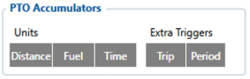*PTO Acumulators* - feature that calculates elements on PTO event.
The Report can include:

| Units | Extra Triggers |
| --- | --- |
| Distance - distance travelled on PTO event. | Periodic - Generated after every periodic Tacho record generation |
| Fuel - fuel used while on PTO event. | Trip - Generated on Trip start or Trip end. |
| Time - time in seconds of how long the PTO event lasted. | — |

---

**Fuel While Driving Accumulators**

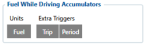*Fuel While Driving Acumulators* - feature that calculates fuel while driving.
The Report can include:

| Units | Extra Triggers |
| --- | --- |
| Fuel - fuel used while driving. | Periodic - Generated after every periodic Tacho record generation |
| — | Trip - Generated on Trip start or Trip end. |

---

**Fuel While Idle Accumulators**

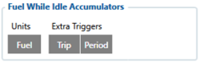*Fuel While Idle Acumulators* - feature that calculates fuel while vehicle is idle.
The Report can include:

| Units | Extra Triggers |
| --- | --- |
| Fuel - fuel used while vehicle is idle. | Periodic - Generated after every periodic Tacho record generation |
| — | Trip - Generated on Trip start or Trip end. |

---

**Fuel Consumption Under Load Accumulators**

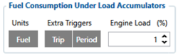*Fuel Consumption Under Load Acumulators* - feature that calculates fuel consumption under load
The Report can include:

| Units | Extra Triggers | Ranges |
| --- | --- | --- |
| Fuel - fuel used while vehicle is under load. | Periodic - Generated after every periodic Tacho record generation | Engine Load (%) - Engine load threshold for Engine load to be detected. |
| — | Trip - Generated on Trip start or Trip end. | — |

---

**Total Accumulators**

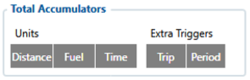*Total Accumulators* - feature that calculates elements total values.
The Report can include:

| Units | Extra Triggers |
| --- | --- |
| Distance - Total calculated distance during the trip | Periodic - Generated after every periodic Tacho record generation |
| Fuel - Total fuel used during the trip | Trip - Generated on Trip start or Trip end. |
| Time - Total calculated time during the trip | — |

---

**Number of Stops Accumulators**

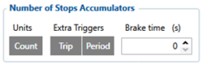*Number of stops Acumulators* - feature that calculates Number of stops during the trip
The Report can include:

| Units | Extra Triggers | Ranges |
| --- | --- | --- |
| Count - Number of stops during the trip. | Periodic - Generated after every periodic Tacho record generation | Brake time (s) - Braking time threshold for number of stops to be detected. |
| — | Trip - Generated on Trip start or Trip end. | — |

---

**Number of Parking Brake Accumulators**

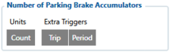*Number of Parking Brake Accumulators* - feature that calculates total number of parking brakes.
The Report can include:

| Units | Extra Triggers |
| --- | --- |
| Count - Number of total parking brakes | Periodic - Generated after every periodic Tacho record generation |
| — | Trip - Generated on Trip start or Trip end. |

---

**Number of Harsh Acceleration Accumulators**

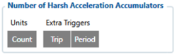*Number of Harsh Acceleration Accumulators* - feature that calculates total number harsh acceleration.
The Report can include:

| Units | Extra Triggers |
| --- | --- |
| Count - Number of total parking brakes | Periodic - Generated after every periodic Tacho record generation |
| — | Trip - Generated on Trip start or Trip end. |

---

**Number of Harsh Braking Accumulators**

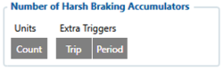*Number of Harsh Acceleration Accumulators* - feature that calculates total number of harsh braking during trip
The Report can include:

| Units | Extra Triggers |
| --- | --- |
| Count - Number of total parking brakes | Periodic - Generated after every periodic Tacho record generation |
| — | Trip - Generated on Trip start or Trip end. |

---

**Number of Harsh Cornering Accumulators**

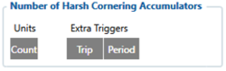*Number of Harsh Cornering Accumulators* - feature that calculates total number of harsh cornering during trip
The Report can include:

| Units | Extra Triggers |
| --- | --- |
| Count - Number of total parking brakes | Periodic - Generated after every periodic Tacho record generation |
| — | Trip - Generated on Trip start or Trip end. |

---

**Speed Range Accumulators**

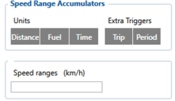*Speed Range Accumulators* - feature that calculates selected unit during certain speed ranges.
The Report can include:

| Units | Extra Triggers | Ranges | — |
| --- | --- | --- | --- |
| Distance - Distance traveled when speed was on a set speed range. | Periodic - Generated after every periodic Tacho record generation | Speed ranges (km/h) - range boundaries in km/h separated by "," for "Speed Ranges" IO's Each number determines the start of a new range. Values should come in ascending order and should not repeat. | — |
| Fuel - Fuel used on a trip when speed was on a set speed range | Trip - Generated on Trip start or Trip end. | Speed ranges (km/h) - range boundaries in km/h separated by "," for "Speed Ranges" IO's Each number determines the start of a new range. Values should come in ascending order and should not repeat. | — |
| Time - Total calculated time during the trip on a set speed range. | — | — | — |

---

**RPM Range Accumulators**

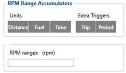*RPM Range Accumulators* - feature that calculates selected units during certain RPM ranges.
The Report can include:

| Units | Extra Triggers | Ranges | — |
| --- | --- | --- | --- |
| Distance - Distance traveled when speed was on a set speed range. | Periodic - Generated after every periodic Tacho record generation | RPM ranges (rpm) - range boundaries in (rpm) separated by "," for "RPM Ranges" IO's Each number determines the start of a new range. Values should come in ascending order and should not repeat. | — |
| Fuel - Fuel used on a trip when speed was on a set speed range | Trip - Generated on Trip start or Trip end. | RPM ranges (rpm) - range boundaries in (rpm) separated by "," for "RPM Ranges" IO's Each number determines the start of a new range. Values should come in ascending order and should not repeat. | — |
| Time - Total calculated time during the trip on a set speed range. | — | — | — |

---

**Torque Range Accumulators**

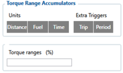*Torque Range Accumulators* - feature that calculates selected units during certain Torque ranges.
The Report can include:

| Units | Extra Triggers | Ranges | — |
| --- | --- | --- | --- |
| Distance - Distance traveled when speed was on a set speed range. | Periodic - Generated after every periodic Tacho record generation | Torque ranges (%) - range boundaries in % separated by "," for "Torque Ranges" IO's Each number determines the start of a new range. Values should come in ascending order and should not repeat. | — |
| Fuel - Fuel used on a trip when speed was on a set speed range | Trip - Generated on Trip start or Trip end. | Torque ranges (%) - range boundaries in % separated by "," for "Torque Ranges" IO's Each number determines the start of a new range. Values should come in ascending order and should not repeat. | — |
| Time - Total calculated time during the trip on a set speed range. | — | — | — |

---

**Braking Range Accumulators**

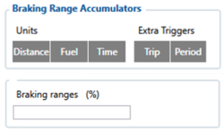*Braking Range Accumulators* - feature that calculates selected units during certain Braking ranges.
The Report can include:

| Units | Extra Triggers | Ranges | — |
| --- | --- | --- | --- |
| Distance - Distance traveled when speed was on a set speed range. | Periodic - Generated after every periodic Tacho record generation | Braking ranges (%) - range boundaries in % separated by "," for "Braking Ranges" IO's Each number determines the start of a new range. Values should come in ascending order and should not repeat. | — |
| Fuel - Fuel used on a trip when speed was on a set speed range | Trip - Generated on Trip start or Trip end. | Braking ranges (%) - range boundaries in % separated by "," for "Braking Ranges" IO's Each number determines the start of a new range. Values should come in ascending order and should not repeat. | — |
| Time - Total calculated time during the trip on a set speed range. | — | — | — |

---

**Fuel Rate Range Accumulators**

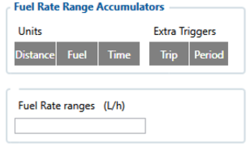*Fuel Rate Range Accumulators* - feature that calculates selected units during certain fuel rate ranges.
The Report can include:

| Units | Extra Triggers | Ranges | — |
| --- | --- | --- | --- |
| Distance - Distance traveled when speed was on a set speed range. | Periodic - Generated after every periodic Tacho record generation | Fuel Rate ranges (L/h) - range boundaries in L/h separated by "," for "Fuel Rate Ranges" IO's Each number determines the start of a new range. Values should come in ascending order and should not repeat. | — |
| Fuel - Fuel used on a trip when speed was on a set speed range | Trip - Generated on Trip start or Trip end. | Fuel Rate ranges (L/h) - range boundaries in L/h separated by "," for "Fuel Rate Ranges" IO's Each number determines the start of a new range. Values should come in ascending order and should not repeat. | — |
| Time - Total calculated time during the trip on a set speed range. | — | — | — |

<!-- configurator-companions -->

## Configurator notes (EN)

English notes translated from the Configurator tab PDFs, generated **2026-11-05**:

- [`configurator/fmsed.md`](configurator/fmsed.md) — FMSED: FMS ECO counters and eco-driving indicators.

