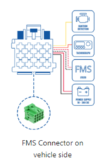
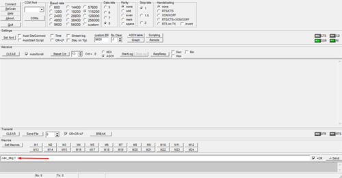

# FMC650 Locked FMS Feature

# Introduction

European market trucks have an FMS interface for telematics device connection/data reading. This is the "Default" connection used for FMX6 devices - you can find FMS Plug locations in different vehicles on our [wiki site](https://wiki.teltonika-gps.com/view/How_to_connect_FMC650_with_FMS_Cable#FMS_Plug_Location).

However, – depending on truck equipment (region/equipment differences) some trucks don’t have an FMS block installed/activated (**further – locked FMS**). Then a different connection to trucks CAN lines is required. Our old solution – propose an LVCAN adapter together with an FMX6 device.

**The locked FMS reading solution is to eliminate the LVCAN adapter and read data with FMX6 only.**

# Solution

Instead of connecting LVCAN to the truck - we propose connecting **FMX6 device with ECAN02 (contact-less CAN reader).**

If you have a truck with locked FMS - no FMS plug or FMS is disabled by the manufacturer - **please fill in the Helpdesk Query with information about the truck's Manufacturer/Model and Model Year.**

After creating a Helpdesk ticket, the appropriate scheme and additional information will be provided.

# Instructions

These are the steps that should be performed during the tests. These steps describe what should be done in case the data is received and also what to do if the data is not received.

1. Connect FMX6 CAN1 High to schemes CAN High / CAN1 Low to schemes CAN Low - **use ECAN02 adapter to avoid CAN line interruptions.**
2. Turn on the vehicle Engine.
3. Send [scanfms SMS/GPRS command](https://wiki.teltonika-gps.com/view/FMC640_SMS/GPRS_command_list).
4. If response is 0,0,0,0... - change CAN1 baudrate from 250 to 500 kbps - **Note: do not change the baudrate with Engine/Ignition ON if FMX6 device is connected directly to CAN line of vehicle - ECAN02 connection is recommended in all cases.**
5. Send scanfms command again.
6. If response has active elements ..1,0,1,1,... - you can configure the FMS IO element accordingly.

Please send us the scanfms response and baudrate used. If you encounter any issues - please send the configuration of the device/GSM number/photos of the connection.

You can also send us a log file gathered by connecting the device to the PC and sending ".can_dbg:1" and ".can_dbg_filter:1" commands via the terminal application.

**Note: remember to send ".can_dbg:0" after the logging is done.**

You can also get a remote log file by sending log2srv SMS/GPS command - log2srv 1,7,APN,APN_Login,APN_Password,Server_IP,Port,600,0 - make sure 7 filter is used instead of default 3. Additionally - send "can_dbg:1" and "can_dbg_filter:1" commands and turn of CAN logging with "can_dbg:1".

Instruction can be found by [pressing here](https://wiki.teltonika-gps.com/view/How_to_capture_CAN_adapter_log_from_FM_device%3F).
