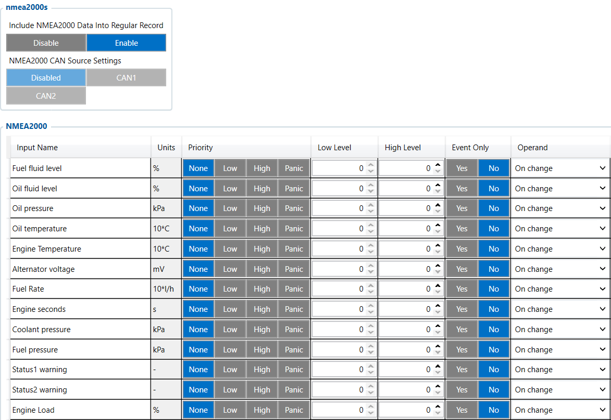

# NMEA 2000 — Configurator notes (EN)

> **Note:** Supplementary notes extracted from the French PDF of the
> Configurator tab `nmea2000-tab.pdf`, generated on
> **2026-11-05T08:37:58Z** — newer than the wiki snapshot kept in
> this folder. The text was translated into English; it complements the
> reference page [`nmea2000.md`](../nmea2000.md).
> PDF extraction quirks: section titles sometimes appear after the text
> they introduce, figures reuse file names from page 1, and some wide
> tables are restituted row by row because the PDF text layer does not
> always preserve the columns. Unarchived `docs.tinolyx.com` image links
> were removed; unique figures are grouped under `## Figures`.

<!-- PDF p. 2 -->

1. Marine instrumentation & vessel: Remote transmission of boat parameters (outboard/inboard engine, tank level, water depth, wind speed).

2. Specialized machinery & generator set: Acquisition of parameters from industrial or agricultural machines using the NMEA2000 bus.

3. Hybrid energy monitoring: Accurate tracking of battery banks and chargers communicating over NMEA2000.

## NMEA2000

The NMEA2000 tab extends the use of the FMC650 beyond automotive and
Heavy Goods Vehicles:

<!-- PDF p. 3 -->

The NMEA2000 tab is the interface dedicated to decoding the basic standardized NMEA 2000 protocol (IEC 61162-3) on the CAN bus.
Initially designed for the maritime sector and specialized machinery, this data bus allows the
FMC650 to acquire an extended set of engine, fuel, electrical,
environmental and nautical data.
This section controls the software activation and the physical assignment of the CAN controller for the
NMEA2000 protocol.
Include NMEA2000 Data Into Regular Record: Enable
Function: Allows the FMC650 to integrate the captured NMEA2000 data into the
stream of regular AVL records sent to the telematics server.
NMEA2000 CAN Source Settings: Disabled (Options: Disabled, CAN1, CAN2)
Critical analysis: The main switch is set to Disabled. No CAN bus
(CAN1 or CAN2) is assigned to reading NMEA2000 messages. Consequently,
the NMEA2000 stream is completely cut off at the hardware level, making the
module inactive despite the recording option being enabled.

### 1. General Role of the NMEA2000 Tab

### 2. System Configuration and NMEA2000 Bus Routing

```
┌──────────────────────────────────────────────────────────────────────────┐
│                   CAN ROUTING DIAGNOSTIC - NMEA2000                      │
└──────┬────────────────────────────────────────────────────┬──────────────┘
       │                                                    │
       ▼                                                    ▼
┌───────────────────────────────┐               ┌───────────────────────────┐
│  REGISTER OVERRIDE            │               │    PHYSICAL CAN SOURCE    │
├───────────────────────────────┤               ├───────────────────────────┤
│ Periodic recording:           │               │ NMEA2000 CAN source:      │
│ [ENABLE] ✅                   │               │ [DISABLED] ❌             │
└──────────────┬────────────────┘               └─────────────┬─────────────┘
               │                                              │
               └──────────────────────┬───────────────────────┘
                                      │
                                      ▼
                      ┌───────────────────────────────┐
```

<!-- PDF p. 4 -->

The module includes a complete dictionary of variables categorized by application domain:
Fuel fluid level (%): Fuel level in the tank.
Fuel Rate (L/h): Instantaneous fuel flow / consumption.
Trip fuel used (L): Total amount of fuel consumed during the trip.
Distance to empty (m): Estimated remaining distance before the tank runs dry.
Engine Temperature (°C): Engine operating temperature.
Engine Load (%): Instantaneous applied engine load.
Engine torque (%): Instantaneous engine torque.
Engine seconds (s): Total engine operating time counter (engine hours expressed in seconds).
Oil fluid level (%): Engine oil level.
Oil pressure (kPa): Engine oil pressure.
Oil temperature (°C): Engine oil temperature.
Coolant pressure (kPa): Coolant circuit pressure.
```
                      │   RESULT: HARDWARE LOCKOUT    │
                      │  No NMEA2000 frames read      │
                      └───────────────────────────────┘
```

### 3. Detailed Dictionary of NMEA2000 Parameters

#### A. Fuel Data

#### B. Engine & Transmission Data

#### C. Oil & Coolant Data

#### D. Electrical & Battery Data

<!-- PDF p. 5 -->

Battery Voltage (mV): Battery voltage.
Battery Current (mA): Battery charge/discharge current.
Battery Temperature (°C): Battery temperature.
State of charge (%): Battery state of charge (SoC).
Charger status / Charger Algorithm: Status and algorithm of the on-board charger.
Air temperature (°C): Ambient air temperature.
Wind speed (m/s): Wind speed.
Water Depth (Transducer / Surface) (cm): Water depth measured relative to the
transducer or to the surface.
Water Temperature (°C): Water temperature.
Status1/2 warning / Alert Status: Alert and warning registers of the network

## NMEA2000.

For all the variables in this tab, the sampling configuration presents a
major peculiarity:
Priority: None (No event priority to trigger an emergency GSM send).
Low Level / High Level: 0 / 0 (No alert thresholds configured).
Event Only: No (Continuous processing).
Operand: On change ⚡
Technical analysis: Unlike most other tabs (FMS IO, LVCAN, Reefer IO) which operate in Monitoring mode (periodic scanning),
the NMEA2000 tab is configured for On change. Data is recorded and
transmitted only when a value change is detected on the network, reducing

#### E. Environmental & Marine Data

### 4. System Configuration: The Operand = On change Specificity

<!-- PDF p. 6 -->

thus the size of the transmitted frames if the CAN source were to be activated.
Tab / Module
CAN
Protocol / Target
Acquisition mode
(Operand)
CAN source
configured
Stream status
FMS I/O
SAE J1939 (Heavy Vehicles)
Monitoring
CAN1 (via CAN/Tachograph)
Active
Tachograph Data
K-Line / CAN
Tachograph
Monitoring
CAN1 (via CAN/Tachograph)
Active
Manual CAN
Raw CAN Frame /
Custom
Frame-by-frame decoding
CAN1 / CAN2
Custom
Manual CAN
Requests
Polling OBD2 / ECU
(SAE J1979)
Periodic (Polling)
CAN1 / CAN2
Custom
Reefer IO
Refrigeration Unit
Buses
Monitoring
RS232 / CAN Port
Inactive
NMEA2000
NMEA 2000 (IEC 61162-3)
On change
Disabled (Deactivated)
Inactive (Blocked)
Tab
Main role
Type of data
Primary business use
FMS I/O
Engine & chassis data
Technical (RPM, fuel, AdBlue)
Maintenance, truck fuel
management
Manual CAN
Custom decoding
Raw / Proprietary (hexadecimal IDs)
Specific captures not
FMS
Manual CAN Requests
ECU polling
Request/Response
Diagnostics, specific PIDs
Manual CAN Commands
Network actuation
Commands / Orders
Control of third-party
equipment
Tachograph Data
Regulatory & social
data
Legal / Driver (Cards, driving time)
Compliance, payroll, time
tracking
RS232 / RS485
Serial interfacing & NMEA
filtering
Peripheral
communication / raw GNSS
External sensors, Garmin,
GPS streams
Complete Comparison of Buses and Acquisition Modules
CAN on the FMC650
Updated global comparative summary (including the NMEA2000 tab)

| Tab/Module | Protocol/Target | Acquisitionmode |  |  |  | CANSource | StreamStatus |
| --- | --- | --- | --- | --- | --- | --- | --- |
| CAN |  | (Operand) |  |  |  | configured |  |
| FMSI/O | SAEJ1939(Heavy Vehicles) |  | Monitoring |  |  | CAN1(via CAN/Tachograph) | Active |
| TachographData | K-Line / CAN Tachograph |  | Monitoring |  |  | CAN1(via CAN/Tachograph) | Active |
| ManualCAN | RawCANFrame/ Custom | Decoding |  | framebyframe |  | CAN1/CAN2 | Custom |
| ManualCAN | PollingOBD2/ECU | Periodic(Polling) |  |  |  | CAN1/CAN2 | Custom |
| Requests | (SAEJ1979) |  |  |  |  |  |  |
| ReeferIO | RefrigerationUnit Buses |  | Monitoring |  |  | RS232/CANPort | Inactive |
| NMEA2000 | NMEA2000(IEC 61162 3)- |  | On change |  |  | Disabled(Deactivated) | Inactive(Blocked) |

| Tab | Mainrole | Typeofdata | Primarybusinessuse |
| --- | --- | --- | --- |
| FMSI/O | Enginedata&chassis | Technical(RPM, AdBlue fuel), | Maintenance management, truckfuel |
| ManualCAN | Customdecoding | Raw/Proprietary(hexadecimalIDs) | Specificcapturesnot FMS |
| ManualCANRequests | ECU polling | Request/Response | Diagnostics, specificPIDs |
| ManualCANCommands | Networkactuation | Commands/Orders | Controlofthird-party equipment |
| TachographData | Regulatory&social data | Legal/Driver(Cards, drivingtime) | Compliance payroll, timetracking |
| RS232/RS485 | Serialinterfacing&NMEA filtering | Peripheral communication/rawGNSS | Externalsensors Garmin, GPSstreams |

<!-- PDF p. 7 -->

**Tab**

Main role
Type of data
Primary business use
CAN \ Tachograph
CAN bus routing & streams
DDD
Hardware configuration &
server routing
Legal DDD download,
CAN speeds
Custom Scenarios
Rules engine &
local automation
Embedded Boolean
logic
Local alerts, engine
cut-off, automation
Reefer IO
Cold chain telematics
overall
Thermal, compressor &
unit alarms
Refrigeration traceability,
complete unit
TK Transcan IO
Interface Thermo King
Transcan
Recorder probes &
standard statuses
Legal traceability
standard recorder
Transcan Advance
Advanced Datalogger
Gateway
8 Temperatures, Humidity,
Statuses/Alarms
Multi-zone datalogger &
hygrometry
Euroscan IO
Datalogger Interface
Euroscan
6 Temperature probes &
4 Digital inputs
Certified traceability
Euroscan recorder
TK Touchprint IO
Interface Thermo King
Touchprint
3 Setpoints & 6
Inputs
Setpoint traceability &
on-board printer
NMEA2000
Marine / Industrial Bus
Acquisition
Engine, Fuel,
Battery, Depth, Wind
Marine telematics &
special machinery
NMEA2000 Logical Architecture
```
 ┌──────────────────────────────────────────────────────────────────────────┐
 │                      NMEA2000 ON-BOARD NETWORK                           │
 └───────────────────────────────────┬──────────────────────────────────────┘
                                     │
                             CAN BUS link
                                     │
                                     ▼
 ┌──────────────────────────────────────────────────────────────────────────┐
 │                          FMC650 (NMEA2000)                               │
 ├──────────────────────────────────────────────────────────────────────────┤
 │ NMEA2000 CAN Source: DISABLED ❌ (Physically inactive)                   │
 │ Include NMEA2000 Data: ENABLE ✅                                         │
 └──────┬────────────────────────────────────────────────────┬──────────────┘
        │                                                    │
        ▼                                                    ▼
   Variables Engine / Fuel / Battery                  Variables Marine / Environment
   Operand: On change                                 Operand: On change
   Priority: None                                     Priority: None
   Limits: 0 / 0                                      Limits: 0 / 0
        │                                                    │
        └────────────────────────────┬───────────────────────┘
```

| Tab | Mainrole | Typeofdata | Primarybusinessuse |
| --- | --- | --- | --- |
| CAN\Tachograph | CANbusrouting&DDD streams | Hardwareconfiguration& serverrouting | LegalDDDdownload, CANspeeds |
| CustomScenarios | Rulesengine& localautomation | EmbeddedBoolean logic | Localalerts cut-off, engine automation, |
| ReeferIO | Coldchaintelematics overall | Thermal compressor&, unit alarms | Refrigerationtraceability, completeunit |
| TKTranscanIO | ThermoKingInterface Transcan | Recorderprobes& standardstatuses | Legaltraceability standardrecorder |
| TranscanAdvance | DataloggerGateway Advanced | 8Temperatures Humidity, Statuses/Alarms | Datalogger multi-zones & hygrometry |
| EuroscanIO | DataloggerInterface Euroscan | 6Temperatureprobes& 4Digitalinputs | Certifiedtraceability Euroscanrecorder |
| TKTouchprintIO | ThermoKingInterface Touchprint | 3Setpoints&6 Inputs | Setpointtraceability& on-boardprinter |
| NMEA2000 | MarineBusAcquisition/ Industrial | Engine Fuel, Battery Depth Wind, | Marinetelematics& specialmachinery |

<!-- PDF p. 8 -->

```
│
                                     ▼
                      ┌─────────────────────────────┐
                      │     Wialon / AVL Server     │
                      │ (Not fed by NMEA2000)       │
                      └─────────────────────────────┘
```

## Figures

Unique figures extracted from the PDF. The extraction reuses the same file
names for all pages; each image is therefore referenced only once here.



