# Part 2 — Flespi to Wialon Telemetry & Sensor Mapping Architecture

> [!IMPORTANT]
> **Two Foundational Engineering Rules**
> 1. **Never confuse telemetry parameters with configuration parameters.**
>    - **Configuration parameters (`Parameter ID` / `PID`)** live inside the FMC650 non-volatile flash (`re/fmx65_03.01.01.Rev.15_schema.json`) and are read/written via `getparam`/`setparam`, FOTA Web, or Flespi **Device Settings**. Wialon **never** automatically reads or synchronizes FMC650 configuration `PID`s into Wialon sensors.
>    - **Telemetry parameters (`AVL ID` -> Flespi `parameter` -> Wialon `p`)** are live measurements transmitted inside Codec 8 / Codec 8 Extended (`0x8E`) packets, normalized by Flespi into dotted telemetry parameters, and forwarded to Wialon where Wialon **Sensors** (`avl_unit` `.wlp` definitions) evaluate formulas on incoming message keys.
> 2. **Never assume a manufacturer parameter maps directly to a Flespi setting or Wialon sensor.**
>    - A Wialon sensor key (`p`) depends entirely on **how the FMC650 is connected to Wialon** (Path A via Flespi Stream vs Path B Direct TCP/TLS to Wialon) and whether **Flespi Plugins / Expressions** (`tidj.*`, `vhc.*`) or **Manual CAN J1939 PGN decoders** (`manual.can.*`) sit in the middle of the pipeline.

---

## 1. End-to-End 3-Stage Architecture (`Teltonika FMC650` -> `Flespi` -> `Wialon`)

```mermaid
flowchart LR
    subgraph S1["Stage 1: Teltonika FMC650 (Firmware 03.01.01.Rev.15)"]
        CFG["Configuration Flash (re/)<br/>Parameter IDs (PIDs)<br/>e.g. PID 70000..70695 Manual CAN<br/>PID 40000..43254 FMS/Tacho IOItems"]
        HW["Hardware / CAN / K-Line / EBS<br/>J1939 FMS + ISO 11992 Trailer + Tacho"]
        CODEC["Codec 8 Extended (0x8E) Packet<br/>2-Byte Telemetry AVL IDs<br/>e.g. AVL 239, 66, 85, 145, 192, 10510"]
        CFG -.->|"Enables & sets sampling/filtering"| HW
        HW --> CODEC
    end

    subgraph S2["Stage 2: Flespi Telematics Hub"]
        CH["Flespi teltonika Channel<br/>Decodes AVL IDs -> 1,161 Dotted Params<br/>e.g. can.engine.load.level<br/>external.powersource.voltage<br/>tacho.vehicle.mileage<br/>manual.can.0"]
        PLG["Flespi Analytics Plugin (tidj.*)<br/>Computes 58 Derived Weight &<br/>Fraud-Detection Telemetry Params<br/>e.g. tidj.weight.cargo, tidj.anomaly.code"]
        STR["Flespi -> Wialon Stream<br/>(wialon / wialon_retranslator)<br/>Abbreviates tokens & applies<br/>tco_* / fuel_lvl / eng_mth overrides"]
        CH --> PLG
        CH --> STR
        PLG --> STR
    end

    subgraph S3["Stage 3: Wialon Hosting / Local (FMC650_TEST_TR84_UNIT_PROFILE.wlp)"]
        MSG["Incoming Wialon Message Parameters (p)<br/>e.g. can_eng_load_lvl, ext_pwrs_vlt,<br/>tco_distance, manual_can_0,<br/>fleet_weight_cargo"]
        SENS["147 Wialon Unit Sensors (IDs 1..150)<br/>Applies scaling formulas (const),<br/>calibration tables (tbl), & state labels (ci)"]
        MSG --> SENS
    end

    CODEC ==>|"TCP / TLS"| CH
    STR ==>|"Wialon Stream"| MSG
```

---

## 2. Path A (Flespi Stream) vs Path B (Direct Teltonika -> Wialon) — Critical Incompatibility

When integrating a Teltonika FMC650 with Wialon, there are **two mutually incompatible parameter naming conventions**. Mixing them up causes Wialon sensors to show `N/A` (`Inconnu`):

| Feature | Path A — Via Flespi Stream (`FMC650_TEST_TR84_UNIT_PROFILE.wlp`) | Path B — Direct Teltonika -> Wialon (`Teltonika FMC650` Unit Type) |
| :--- | :--- | :--- |
| **Transport Pipeline** | `FMC650` -> `Flespi Channel (teltonika)` -> `Flespi Stream (wialon)` -> `Wialon` | `FMC650` -> `Wialon (Teltonika FMC650 port)` directly |
| **How Telemetry `AVL ID` is Named in Wialon** | Semantic abbreviated underscore name derived from Flespi's dotted parameter name (e.g., `eng_ign_stat`, `ext_pwrs_vlt`, `can_eng_load_lvl`, `tco_distance`, `manual_can_0`) | Raw numbered I/O key **`io_<AVL_ID>`** (e.g., `io_239`, `io_66`, `io_85`, `io_192`, `io_145`) plus a few hardcoded aliases (`pwr_ext`, `pwr_int`, `gsm`, `hdop`, `pdop`, `vin`) |
| **Unit Scaling before Wialon** | **Flespi normalizes physical units** before streaming (e.g., `AVL ID 66` mV -> `ext_pwrs_vlt` in **Volts**; `AVL ID 17..19` mG -> `x_accel` in **g**; `AVL ID 253` split into 3 boolean events) | **Wialon receives raw unscaled Teltonika integers** (e.g., `io_66` is in **mV**, `io_17` is in **mG**, `io_253` is integer `1/2/3`), except `pwr_ext` which Wialon divides by `1000` |
| **Flespi Plugin Parameters (`fleet_*`, `vhc_*`)** | Present (**58 derived weight/anomaly parameters** in `FMC650_TEST_TR84_UNIT_PROFILE.wlp`) | **Absent** (do not exist on the tracker; computed in Flespi cloud) |
| **Compatible with `FMC650_TEST_TR84_UNIT_PROFILE.wlp`?** | **YES (100% designed for Path A)** | **NO** — importing `FMC650_TEST_TR84_UNIT_PROFILE.wlp` onto a direct Teltonika unit in Wialon will leave all 147 sensors blank! |

---

## 3. Exact Flespi -> Wialon Parameter Name Translation Rules

When Flespi streams a device message to Wialon, Flespi's Wialon protocol serializer converts each official dotted **Flespi Telemetry Parameter** into a Wialon parameter key (`p`) using a **two-step deterministic algorithm**:

### Step 3.1 — Priority 1: Legacy Wialon Retranslator Override Table
First, if the Flespi parameter matches a standard Wialon Retranslator / Wialon Combine built-in telemetry field, Flespi maps it to Wialon's reserved short name instead of abbreviating its tokens:

| Official Flespi Parameter Name | Wialon Stream Parameter Key (`p`) | Teltonika Telemetry `AVL ID`(s) | Verified in `FMC650_TEST_TR84_UNIT_PROFILE.wlp` |
| :--- | :--- | :--- | :--- |
| `position.latitude` | `lat` | GPS Header (Bytes 8..11) | Sensor `83` (`Latitude`) |
| `position.longitude` | `lon` | GPS Header (Bytes 4..7) | Sensor `84` (`Longitude`) |
| `position.speed` | `speed` | GPS Header (Bytes 16..17) | Built-in Wialon speed |
| `position.direction` | `course` | GPS Header (Bytes 14..15) | Built-in Wialon course |
| `position.satellites` | `sats` | GPS Header (Byte 15) | Built-in Wialon satellites |
| `tacho.vehicle.mileage` | `tco_distance` | `192`, `133`, `10151` | Sensors `15`, `27` (`Kilométrage Tachygraphe`) |
| `tacho.trip.mileage` | `tco_trip_distance` | `10152` | Sensor `33` (`Distance du trajet (Tachy)`) |
| `tacho.position.speed` | `tco_pos_speed` | `191`, `126`, `135`, `10156` | Sensor `17` (`Vitesse Tachygraphe`) |
| `tacho.overspeeding.status` | `tco_overspeed_stat` | `186`, `117`, `10155` | Sensor `18` (`Dépassement de vitesse (Tachy)`) |
| `tacho.drive.recognize.status` | `tco_drive_recognize_stat` | `190`, `125`, `10154` | Sensor `41` (`Reconnaissance de conduite`) |
| `tacho.data.source` | `tco_data_source` | `10177` | Sensor `49` (`Source données Tachygraphe`) |
| `tacho.driver.activity.state.1` / `tacho.driver.work.state.1` | `tco_activity_type1` | `184`, `115`, `137`, `10159` | Sensors `36`, `86..89` (`Statut d'activité Conducteur 1`) |
| `tacho.driver.activity.duration.1` | `tco_activity_tm1` | `60`, `143`, `10173` | Sensor `37` (`Durée d'activité Conducteur 1`) |
| `tacho.driver.cumulative_break.duration.1` | `tco_break_tm1` | `58`, `141`, `10171` | Sensor `38` (`Temps de pause cumulé Conducteur 1`) |
| `tacho.driver.continuous_driving.duration.1` | `tco_continuous_driving_tm1` | `56`, `139`, `10169` | Sensor `39` (`Temps de conduite continue Conducteur 1`) |
| `tacho.driver.cumulative_driving.duration.1` | `tco_cumulative_driving_tm1` | `69`, `145`, `10175` | Sensor `40` (`Temps de conduite cumulé (2 sem.)`) |
| `tacho.driver.time.state.enum.1` | `tco_driver_tm_st_enum_1` | `189`, `118`, `10163` | Sensor `42` (`État limite de temps Conducteur 1`) |
| `can.fuel.level` | `fuel_lvl` | `89`, `48`, `10428` | Sensor `2` (`Niveau Carburant`) |
| `can.fuel.rate` / `can.fuel.consumption` | `can_fuel_cons` | `110`, `84` | Sensor `3` (`Taux de consommation Carburant`) |
| `can.fuel.economy` | `can_fuel_eco` | `136` | Sensor `12` (`Économie de carburant instantanée`) |
| `can.engine.motorhours` | `eng_mth` | `105`, `102`, `14` | Sensors `30`, `58` (`Heures Moteur`) |

> [!WARNING]
> **Why Sensor `118` uses `tacho_driver_daily_driving_dur_1` instead of `tco_*`**:
> Only the classic Wialon Retranslator tachograph fields listed above have `tco_*` overrides. Newer Flespi tachograph parameters such as `tacho.driver.daily.driving.duration.1` (`AVL ID 57 / 140 / 10170`) fall through to Step 3.2 (Token Abbreviation), becoming **`tacho_driver_daily_driving_dur_1`** (verified in Sensor `118` `Temps de conduite quotidien Conducteur 1`).

### Step 3.2 — Priority 2: Token Abbreviation Dictionary (Dot `.` -> Underscore `_`)
For all other Flespi telemetry parameters (including custom Flespi plugin parameters), Flespi splits the parameter name on `.` and abbreviates individual words before joining with `_`:

| Flespi Token | Wialon Abbreviated Token | Example Flespi Parameter | Resulting Wialon Parameter (`p`) |
| :--- | :--- | :--- | :--- |
| `engine` | `eng` | `can.engine.load.level` | `can_eng_load_lvl` |
| `status` | `stat` | `engine.ignition.status` | `eng_ign_stat` |
| `state` | `st` *(see exceptions below)* | `trailer.spring.brake.state.enum` | `trailer_spring_brake_st_enum` |
| `level` | `lvl` | `can.adblue.level` | `can_adblue_lvl` |
| `voltage` | `vlt` | `external.powersource.voltage` | `ext_pwrs_vlt` |
| `temperature` | `temp` | `can.engine.coolant.temperature` | `can_eng_coolant_temp` |
| `pressure` | `press` | `trailer.pneumatic.supply.pressure` | `trailer_pneumatic_supply_press` |
| `vehicle` | `vhc` | `total.vehicle.weight` | `total_vhc_weight` |
| `movement` | `mvm` | `fms.movement.direction` | `fms_mvm_dir` |
| `direction` | `dir` | `fms.movement.direction` | `fms_mvm_dir` |
| `acceleration` | `accel` | `absolute.acceleration` | `absolute_accel` |
| `duration` | `dur` | `tacho.driver.daily.driving.duration.1` | `tacho_driver_daily_driving_dur_1` |
| `position` | `pos` | `position.altitude` | `pos_altitude` |
| `throttle` | `thrt` | `can.throttle.pedal.level` | `can_thrt_pedal_lvl` |
| `request` | `req` | `trailer.amber.warning.request.state.enum` | `trailer_amber_warning_req_st_enum` |
| `external.powersource` | `ext_pwrs` | `external.powersource.voltage` | `ext_pwrs_vlt` |

- **Known Exceptions in `FMC650_TEST_TR84_UNIT_PROFILE.wlp`**:
  - `fms.adblue.state.enum` -> `fms_adblue_state_enum` (`state` is not shortened to `st`).
  - `trailer.calibration.load.level.state.enum` -> `trailer_calibration_load_lvl_state_enum` (`level` -> `lvl`, `state` kept as `state`).
  - `battery.current` -> `battery_current` (`battery` is not shortened to `bat`).

---

## 4. Wialon Sensor Formula Syntax & Scaling Rules Used in `FMC650_TEST_TR84_UNIT_PROFILE.wlp`

Wialon sensor expressions (`"p"` field in `.wlp`) are mathematical formulas evaluated by Wialon's server whenever a message arrives:

1. **Numeric Constants (`const<N>`)**:
   - In Wialon expressions, literal numbers **must** be prefixed with `const` (e.g., `const1000`, `const3600`, `const0.08`, `const9.80665`, `const125`).
   - Examples from `FMC650_TEST_TR84_UNIT_PROFILE.wlp`:
     - Seconds to Hours: `tco_activity_tm1/const3600` (Sensor `37`)
     - Kilograms to Tonnes: `total_vhc_weight/const1000` (Sensor `8`)
     - Meters to Kilometers: `can_service_mileage/const1000` (Sensor `9`)
     - kPa to BAR: `trailer_pneumatic_supply_press/const100` (Sensor `62`)
     - G-force to $\text{m/s}^2$: `absolute_accel*const9.80665` (Sensor `79`)
2. **J1939 SPN Scaling & Offset Decoding on `manual_can_N`**:
   - Because Teltonika Manual CAN (`AVL ID 145..214`) extracts raw unscaled CAN bytes from J1939 frames and Flespi forwards them as raw integers (`manual.can.0..69`), **Wialon must apply the J1939 SPN resolution and offset in the sensor formula**:
     - **SPN 100 (Engine Oil Pressure, 4 kPa/bit)**: `(manual_can_0*const4)/const100` -> BAR (Sensor `20`)
     - **SPN 102 (Boost Pressure, 2 kPa/bit)**: `(manual_can_hex_8*const2)/const100` -> BAR (Sensor `21`)
     - **SPN 105 (Intake Manifold Temp, $1^\circ\text{C}/\text{bit}$, $-40^\circ\text{C}$ offset)**: `manual_can_9-const40` -> °C (Sensor `22`)
     - **SPN 1087 / 1088 (Brake Air Pressure Circuits 1 & 2, 8 kPa/bit)**: `manual_can_20*const0.08` & `manual_can_21*const0.08` -> BAR (Sensors `23`, `24`)
     - **SPN 520 / 523 / 524 (Retarder % Torque & ZF Gears, $1/\text{bit}$, $-125$ offset)**: `manual_can_10-const125`, `manual_can_3-const125`, `manual_can_5-const125` (Sensors `25`, `43`, `45`)
     - **SPN 526 (Actual Gear Ratio, $0.001/\text{bit}$)**: `manual_can_4*const0.001` (Sensor `44`)
     - **Road Slope ($0.002\%/\text{bit}$, $-64\%$ offset)**: `(manual_can_6*const0.002)-const64` (Sensor `54`)
3. **Previous Message Value (`#param`) & Inter-Sensor References (`[Sensor Name]`)**:
   - `#time` refers to the Unix timestamp of the **previous** telemetry message, while `time` is the current message timestamp.
   - `[Rest State]` references the output value of another Wialon sensor by name (`Sensor 86: Rest State`).
   - Example in Sensor `85` (`Driver 1 Rest Validation`): `(time-#time)*[Rest State]/const3600` computes the elapsed hours spent in the Rest state between consecutive packets!
4. **Piecewise-Linear Calibration Tables (`"tbl"`)**:
   - Used in Sensor `2` (`Niveau Carburant`: maps `0..100 %` -> `0..1120 Liters`), Sensor `52` (`Niveau AdBlue`: maps `0..100 %` -> `0..90 Liters`), and Sensors `86..89` (which use step-function `tbl` pairs with `"unbound": 0` to isolate a single `tco_activity_type1` enum value `0`, `1`, `2`, or `3` into a binary `0/1` state!).

---

## 5. Configuration Errors & Bugs Discovered in `FMC650_TEST_TR84_UNIT_PROFILE.wlp`

During our audit of `/home/fleet/Downloads/FMC650_TEST_TR84_UNIT_PROFILE.wlp` against the official Flespi parameter catalog, we identified **5 concrete sensor configuration bugs/duplicates** that should be fixed in production:

| Wialon Sensor ID & Name | Current Formula (`p`) in `.wlp` | Issue / Root Cause | Recommended Fix |
| :--- | :--- | :--- | :--- |
| **Sensor `27`**: `consommation carburant au 100` | `(fuel_consumed*const100)/tco_distance` | Uses `fuel_consumed`, which is **not** the parameter emitted by Flespi for Teltonika FMS fuel used (Sensor `34` correctly uses `can_fuel_consumed`). Also divides lifetime cumulative fuel by lifetime odometer rather than trip delta. | Change `fuel_consumed` to `can_fuel_consumed`: `(can_fuel_consumed*const100)/tco_distance` |
| **Sensor `46`**: `Frein Moteur activé` | `can_thrt_pedal_lvl` | Bound to **`can.throttle.pedal.level`** (Accelerator Pedal % — exact same parameter as Sensor `35`!), instead of an engine brake / retarder status parameter. | Bind to the appropriate Manual CAN SPN (e.g., `manual_can_11 > const0`) or FMS retarder switch parameter. |
| **Sensor `48`**: `Diagnostics pris en charge` | `manual_can_9` | Bound to **`manual_can_9`**, which is already configured in Sensor `22` as **Air Intake Temperature** (`manual_can_9-const40`), instead of Flespi's `fms.diagnostics.supported` (`AVL ID 100`). | Change `p` from `manual_can_9` to **`fms_diagnostics_supported`** (`AVL ID 100`). |
| **Sensor `21`**: `Pression Turbo (Admission)` | `(manual_can_hex_8*const2)/const100` | Uses `manual_can_hex_8` (which Flespi emits as a hexadecimal **string** when configured as hex, or `manual_can_8` when numeric). If Flespi emits hex text (e.g. `"0A"`), arithmetic multiplication fails unless converted or read from numeric `manual_can_8`. | Verify whether Manual CAN 8 is decoded as numeric `manual_can_8` or hex string `manual_can_hex_8`. |
| **Sensors `13` & `57`** (`Contact` / `Contact(2)`) and **Sensors `30` & `58`** (`Heures Moteur` / `Heures Moteur(2)`) | `eng_ign_stat` and `eng_mth` | Exact duplicate sensor definitions with identical parameters (`eng_ign_stat` and `eng_mth`). | Keep one primary sensor per parameter unless required by a specific Wialon module. |

